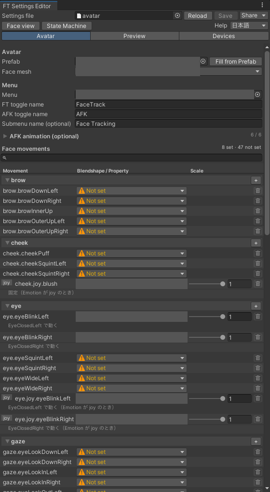
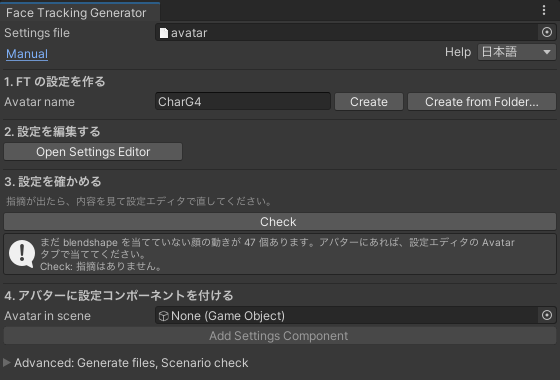
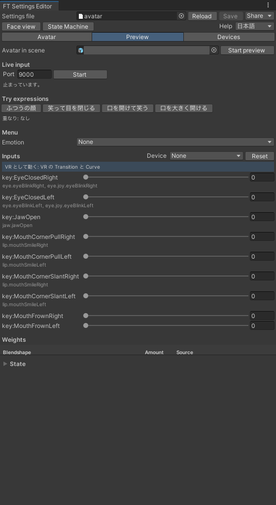

# Face Tracking Generator 説明書

Face Tracking Generator（以下 生成器）は、VRChat のアバターのフェイストラッキング（FT）の設定を、Unity のエディタの中で作る道具です。この説明書は日本語の説明書で、生成器と一緒に配っています。英語の説明はリポジトリの README（https://github.com/kmnk/VRChat_FaceTrackingGenerator ）にあります。

FT の値を表情ごとに測るアプリ FT Measure（ft-measure）の使い方は、FT Measure の説明書（https://github.com/kmnk/ft-measure/blob/master/docs/manual-ja/README.md ）にあります。

## はじめに

### できること

- [顔の動き](#用語集)（まばたき、口の開き、口角など）を、FT の値でアバターのブレンドシェイプに当てます
- 表情の[状態](#用語集)（喜び・怒り・悲しみなど）を作り、FT の値で状態に入る・出る条件（[遷移](#用語集)）を、Unity の Animator に似たグラフで書けます
- 状態ごとに、目や口の動きを上書きしたり、涙や頬の赤らみのようなブレンドシェイプを決まった量で出したりできます
- メニューから状態を選べるようにできます
- VR の機器とデスクトップ（VRChat の Selfie Expression）で、遷移や[強さ](#用語集)を分けて書けます
- アップロードと Play Mode のときに自動で作ります。元のアバター（コントローラー、メニュー、Expression Parameters）は書き換えません

### 仕組み

VRChat は、VR の機器（VRCFaceTracking を通す）やデスクトップの Selfie Expression から、顔の値を受け取ります。この値を[トラッキングキー](#用語集)と呼びます。`EyeClosedLeft`（左目の閉じ具合）や `JawOpen`（あごの開き）のように名前があり、0〜1 の値をとります。

生成器は、トラッキングキーを顔の動き（`eye.eyeBlinkLeft` など）に当て、顔の動きをアバターのブレンドシェイプに当てます。この 2 段の対応を、2 つの設定ファイルに分けて持ちます。

- 表情の設定（`expression.jsonc`）: どのトラッキングキーでどの顔の動きを動かすか、どんな状態があるか。アバターによらないので、別のアバターに持っていけます
- アバターの設定（`avatar.jsonc`）: 顔の動きごとに、このアバターのどのブレンドシェイプを動かすか

出来上がった顔の動きは、VRChat のネイティブ FT（アバターの Avatar Descriptor の Face Tracking の区画）の [Blendshapes Set](#用語集) として書かれます。VRChat がブレンドシェイプを直接動かすので、FT の値をパラメータで同期しません。遷移の条件に使うトラッキングキーだけは、VRChat の [Forward to Animator](#用語集) で Animator に渡します。

### 無表情と状態

何も状態に入っていないときの顔を[無表情](#用語集)（neutral）と呼びます。無表情では、目・口などの[部位](#用語集)ごとに、トラッキングキーが顔の動きを動かします。

状態（喜びなど）に入ると、その状態が上書きする部位だけ、動き方が替わります。たとえば喜びの状態で目を上書きすると、喜んでいる間はまばたきのキーで「笑い目」のブレンドシェイプが動きます。上書きしない部位は、無表情のまま動きます。

状態は[状態の機械](#用語集)（State Machine）の中にあり、遷移の条件（「口角を上げる値が 0.5 を超えたら喜びに入る」など）で切り替わります。状態の機械は複数並べられます。

### VR とデスクトップ

VR の機器とデスクトップの Selfie Expression では、同じ顔をしても値の出方が違います。生成器は、遷移・強さ・Stop visemes を機器ごとに書けます。書かなければ両方で同じです。詳しくは「[VR とデスクトップで分ける](#vr-とデスクトップで分ける)」にあります。

## 動作環境

- Unity 2022.3（VRChat の推奨の版）
- VRChat SDK - Avatars 3.10.6 以上
- NDMF 1.14.7 以上 2.0.0 未満（生成器と一緒に入ります）
- PC 版の VRChat。Android（Quest）版の VRChat では確かめていません
- VR の機器で使うときは、2026-11-02 以降の VRCFaceTracking

Modular Avatar は要りません。入っているプロジェクトでも使えます。

## 入れ方

生成器は VPM のパッケージです。VCC か ALCOM で入れます。

1. NDMF のリポジトリを足します: `https://vpm.nadena.dev/vpm.json`
2. 生成器のリポジトリを足します: `https://kmnk.github.io/vpm-repos/index.json`
3. Unity でプロジェクトを閉じてから、パッケージの一覧で **Face Tracking Generator** を足します
4. Unity でプロジェクトを開き、メニューの `Tools/Kmnk/Face Tracking Generator` を開きます

リポジトリを足せないときは、「[付録: zip から入れる](#付録-zip-から入れる)」を見てください。

## はじめての設定

パーフェクトシンク（ARKit の 52 の名前のブレンドシェイプ）を持つアバターで、生成器の窓の 4 つの手順を通し、Build & Test で顔が動くのを確かめます。パーフェクトシンクでないアバターでも手順は同じで、2 でブレンドシェイプを選ぶ数が増えます（「[パーフェクトシンクでないアバター](#パーフェクトシンクでないアバター)」）。

生成器の窓のボタンの結果は、ボタンのすぐ下に出ます。終わったときは普通の文、見てほしいことがあるときは黄色、失敗したときは赤です。窓の上の **Help** で、説明と手順の見出しを日本語・英語・非表示に切り替えられます。この説明書の画像は日本語で撮っています。

### 1. 設定を作る

1. 生成器の窓の「1. FT の設定を作る」（Help が英語なら Create the FT settings）の **Avatar name** に、アバターの名前を入れます
2. **Create** を押します

`Assets/Kmnk/FaceTrackingGenerator/Settings/<名前>/` に、`avatar.jsonc` と `expression.jsonc` がテンプレートから作られます。表情の設定のテンプレートは、パーフェクトシンクの 52 の名前を無表情で動かし、空の状態の喜び（joy）・怒り（angry）・悲しみ（sad）を持つ状態の機械 `Emotion` を持ちます。

うまくいくと、ボタンの下に作った場所が出て、**Settings file** に作った `avatar.jsonc` が入ります。同じ名前の設定が既にあると何も作りません。そのときは **Settings file** で既にある設定を選んでください。

### 2. 設定を編集する

1. **Open Settings Editor** を押して設定エディタを開きます
2. **Avatar** タブで、アバターのプレハブを選び、**Fill from Prefab** を押します。顔のメッシュ、メニュー、同じ名前のブレンドシェイプを持つ顔の動き、空の AFK のアニメーションが埋まります（Undo で戻せます）
3. 一覧に *Not set* が残った顔の動きがあれば、ブレンドシェイプを選びます
4. **Menu** で、FT と AFK のトグルの名前を決めます。サブメニューに入れたいときは、その名前を入れます（空ならメニューの直下）
5. **Save** を押します

画像のアバターはパーフェクトシンクでないので、*Not set* が多く残っています。ブレンドシェイプとアセットの名前は隠しています。

うまくいくと、**Save** の横の **Unsaved changes** が消えます。パーフェクトシンクのアバターでは、52 の顔の動きのほとんどが埋まります。

### 3. 設定を確かめる

生成器の窓に戻り、**Check** を押します。指摘があれば、読んで設定エディタで直します。

うまくいくと、ボタンの下に「Check: 指摘はありません。」と出ます。*Not set* の顔の動きが残っていると、その数が 1 行で出ます。

### 4. アバターに設定のコンポーネントを付ける

1. シーンにアバターを置きます
2. 生成器の窓の **Avatar in scene** でアバターを選びます（Hierarchy で選んでも入ります）
3. **Add Settings Component** を押します

うまくいくと、アバターに設定のコンポーネント（Face Tracking Generator Settings）が付き、ボタンの下に付けたことが出ます。Inspector でアバターを見ると、コンポーネントに使う設定のファイルが出ています。FT は、Play Mode に入るときとアップロードのときに作られます。元のアバターのコントローラー・メニュー・Expression Parameters は書き換えません。

### 5. Build & Test で確かめる

VRChat SDK の Build & Test でアバターを作り、VRChat で着替えます。

- VR の機器: VRCFaceTracking を動かしてから VRChat を起動します
- デスクトップ: VRChat の Selfie Expression を有効にします

うまくいくと、まばたきや口が自分の顔に合わせて動きます。メニューに FT のトグルと、状態の機械のサブメニューが出ます。FT の入力が無いと、アバターの元の表情に戻ります。顔が動かないときは「[困ったとき](#困ったとき)」を見てください。

## 表情を作る

「はじめての設定」で作った喜び（joy）の状態に、目と口の動きを足します。

### 状態の機械の窓を開く

設定エディタの **State Machine** のボタン（または `Tools/Kmnk/Face Tracking State Machine`）で、状態の機械の窓を開きます。オレンジの状態が最初の状態（無表情）です。

### 状態の顔を作る

1. グラフで **joy** を選びます。右に状態の設定が出ます
2. 目の部位（eye）を **Override** にし、**+ Add Row** で行を足します。行は「トラッキングキー → 顔の動き」です。たとえば `EyeClosedLeft` → `eye.eyeSquintLeft` にすると、喜んでいる間は左目のまばたきで目が細まります
3. 口の部位（lip）も同じように **Override** にし、`MouthCornerPullLeft` → `lip.mouthSmileLeft` のように、口角を上げるキーで笑った口の顔の動きを動かす行を足します。口を決まった形にしたいときは、**Off** にして、口の形を **Fixed face movements** で出します
4. **Fixed face movements** で、喜んでいる間ずっと出すブレンドシェイプ（頬の赤らみなど）を 0〜100 で足します
5. **Save** を押します

状態を選ぶと、Face view にその状態の顔が出ます。

部位の **Off** は、その部位の無表情の動きを止めます。**Don't move** の行は、そのキーで何も動かしません。**Copy from** で、別の状態の行を写せます。

### 遷移の条件を変える

テンプレートの喜びは、`MouthCornerPullLeft` か `MouthCornerPullRight` が 0.5 を超えると入り、両方が 0.4 を下回ると出ます。

1. 遷移（状態の間の線）を選びます
2. 条件の値（[しきい値](#用語集)）を変えます。入りにくければ下げ、入りすぎるなら上げます
3. 左右どちらかで入る形は、同じ状態の間に遷移を 2 本作ります（1 本の遷移の条件はすべて満たす必要があるため）

うまくいくと、右に **Conditions** と条件の値が出て、変えた値が Preview の状態の切り替わりに反映されます。

### Preview で確かめる

1. 設定エディタの **Preview** タブで、シーンのアバターを選び、**Start preview** を押します
2. スライダー（トラッキングキー）を動かすと、顔と状態が変わります
3. **Try expressions** は、崩れやすい表情にスライダーを合わせます。同じ所に重なる顔の動きの数と、警告が出ます
4. **Stop preview** でアバターを元に戻します

Play Mode は要りません。アバターは書き換えません。

### Live input で自分の顔で確かめる

VR の機器を持っているときは、Preview タブの **Live input** で、自分の顔でスライダーを動かせます。

1. VRChat を閉じ、VRCFaceTracking を機器と一緒に動かします
2. VRCFaceTracking の **Send Port** を、Live input の欄のポート（既定は 9000 で、VRCFaceTracking の既定と同じ）に合わせます
3. **Start** を押します

うまくいくと、ボタンの下に値が届いていることが出て、スライダーが顔に合わせて動きます。**Stop** で止めます。Send Port を変えたときは、VRChat を起動する前に戻してください。

### Build & Test で確かめる

「[5. Build & Test で確かめる](#5-build--test-で確かめる)」と同じ手順でアバターを作り、笑うと喜びの状態に入り、目と口が状態の動きに替わることを確かめます。メニューの状態の機械のサブメニューで joy を選んでも、同じ顔になります。

## パーフェクトシンクでないアバター

アバターのブレンドシェイプの名前が ARKit の名前と違うときは、Avatar タブで顔の動きごとにブレンドシェイプを選びます。

- 顔の動きの行を押すと、検索できるブレンドシェイプの一覧が開きます。一覧を動かす間、Face view にそのブレンドシェイプを 100 にした顔が出ます
- 選ばなかった顔の動きは *Not set* のままで、使われません。**Check** がその数を出します
- **[Scale](#用語集)**（0〜1、既定は 1）で、このアバターで強すぎるブレンドシェイプを弱められます。表情の設定は変わらないので、他のアバターに持っていっても影響しません
- **+ Add Face Movement** で顔の動きを足せます。部位の見出しの右の **+** でも同じです
- 顔の動きを右クリックして **Rename…** で、2 つの設定の両方で名前を変えられます。どの状態も使わない顔の動きは、ゴミ箱のボタン（画像を出せないときは **Del**）で消せます
- 一覧には、顔のメッシュのマテリアルの Float と Range のプロパティもあります。状態の決まった量（Fixed face movements）にだけ使え、シェーダーで顔を描くアバターで、状態に合わせて目や口を描き替えるのに使えます

### アバターの元の層

アバターの元の FX の層のうち、顔を動かすものを、FT の間どうするか決めます。

- **Stop while FT**: 手のジェスチャーで表情を変える層
- **Mute while FT**: 何も入力が無くても顔を動かす層（ずっとまばたきさせる層など）。これを止めないと、FT のまぶたの上にまばたきが重なります
- メニューからだけ動かす層は、そのままでかまいません

## VR とデスクトップで分ける

VR の機器とデスクトップの Selfie Expression では、同じ顔でも動くトラッキングキーと値の幅が違います。生成器では、次を機器ごとに書けます。

- 遷移（条件のキーと値）
- 行の強さと[応答の曲線](#用語集)
- 状態の Stop visemes

状態の一覧、メニュー、行のキーと顔の動き、Fixed face movements は、両方の機器で共有します。

### 機器を切り替えて書く

1. State Machine の窓の右上の **Input** で、書く機器（**VR** か **Desktop**）を選びます。ツールバーの下の帯に、どちらを書いているかが出ます

2. グラフには、その機器の遷移が出ます。遷移を足したり条件を変えたりすると、その機器だけが変わります
3. 両方の機器で共通の遷移を変えると、その遷移は 2 つに分かれ、もう片方の機器は元のまま残ります

Preview タブの **Device** で VR かデスクトップを選ぶと、Preview はその機器の遷移と強さで動きます。

### FT Measure で値の幅を見る

FT Measure は、自分の顔で表情ごとに FT の値を測り、記録のファイル（`.jsonl`）に書くアプリです。記録を生成器に読ませると、どのキーがどのくらい動くかを見て、遷移のキーとしきい値を選べます。記録は参考に見るだけで、生成器の出力は変わりません。FT Measure を使わなくても、生成器は使えます。

測り方は FT Measure の説明書（https://github.com/kmnk/ft-measure/blob/master/docs/manual-ja/README.md ）にあります。測った後は次のとおり読ませます。

1. 設定エディタの **Devices** タブで、**Add VR recording** か **Add Desktop recording** を押し、記録のファイルを選びます。`avatar.jsonc` の隣の `Measurements/` に写されます

2. **Recorded faces** で、測った顔（**Face**）を選ぶと、キーごとに、無表情・無表情で話す・笑って話す・その顔での値の幅が出ます。無表情より大きく動くキーが上に並び、ほとんど動かないキーは薄く出ます
3. Preview タブの **Device** に **VR (records)** と **Desktop (records)** が出ます。選ぶと、スライダーの下にその機器の値の幅が出ます。幅の外では黄色、機器が送らないキーはオレンジです

## 状態を足す

### 状態と遷移を足す

- State Machine の窓のグラフの空いた所を右クリックして、状態を足します
- 状態を右クリックして **Make Transition** を選び、行き先の状態を押すと、遷移ができます。**Set as Default** で最初の状態にし、**Delete State** で消します
- 状態をドラッグして動かせます。マウスホイールで拡大・縮小、**F** か **Frame All** で全体を出します

### メニューから選べる状態

状態の **Selectable from menu** を入れると、メニューの状態の機械のサブメニューに、その状態のトグルが出ます。メニューで選んでいる間は遷移が動かず、トグルを切ると最初の状態に戻ります。

### Stop visemes

状態の **Stop visemes** を入れると、その状態の間は、話しても口がビセームで動かなくなります。口の形を決めた状態（舌を出すなど）で使います。

### 応答の曲線

行の **Curve** は、トラッキングキーの値（横）に対して、顔の動きをどのくらい動かすか（縦）を決める曲線です。押すと Unity の曲線の窓で編集できます。曲線の一番高い所が、その行の[強さ](#用語集)になります。

曲線を使った行は、VRChat の Parameter Behavior で動かします。数が多いと VRChat の上限を超えるので、State Machine の窓の下の **Face tracking cost** を見てください。VRChat の上限を超えると赤、Excellent を超えると黄色で出ます。

### 別の状態の機械を並べる

状態の機械は複数並べられます。たとえば表情の `Emotion` とは別に、頬の状態の機械 `Cheek` を作り、メニューから選べる状態 blush（赤らみ）と pale（青ざめ）を置くと、どの表情とも組み合わせられます。状態の機械の窓の左上の一覧で、**New State Machine…** を選んで作ります。2 つの状態の機械が同じ部位を上書きしないようにしてください（**Check** が指摘します）。

## 画面ごとの説明

### 生成器の窓

`Tools/Kmnk/Face Tracking Generator`。

| 名前 | 何をするか |
| --- | --- |
| Settings file | 使う設定（`avatar.jsonc`）。プロジェクトごとに最後に選んだものを覚えます |
| Avatar name | **Create** で作る設定の名前。プロジェクトごとに覚えます |
| Manual | この説明書を開きます |
| Help | 説明を日本語・英語・非表示に切り替えます |
| Create | 入れた名前で、テンプレートから設定を作ります |
| Create from Folder… | **Share** で書き出したフォルダの表情の設定から、設定を作ります |
| Open Settings Editor | 設定エディタを開きます |
| Check | 保存した設定と、作った FX のコントローラーを確かめます |
| Avatar in scene | 設定のコンポーネントを付けるアバター |
| Add Settings Component | アバターに設定のコンポーネントを付けます |
| Generate（Advanced） | アバターを書き換えずに、作ったコントローラーと Prefab Variant を `Assets/FaceTrackingGeneratorOutput/<名前>/` に書きます |
| Scenario check (Play Mode)（Advanced） | 生成器を確かめるための機能です。**scenario .txt** にシナリオのファイルを選び、**Run scenario on the generated prefab** で顔を動かして記録します |

### 設定エディタ

`Tools/Kmnk/Face Tracking Settings Editor`。上の行に **Settings file**・**Reload**・**Save**・**Share**、その下に **Face view** と **State Machine** のボタンがあります。

| 名前 | 何をするか |
| --- | --- |
| Reload | 設定をファイルから読み直します |
| Save | 設定を保存します。保存すると、設定ファイルの `//` のコメントは消えます |
| Share | **Export expression…** で表情の設定をフォルダに書き出し、**Import expression…** でフォルダから読み込みます。アバターの設定は書き出しも上書きもしません |
| Resume | VRChat SDK のビルドが失敗して止まったままのときに、窓を再開します |

窓の題は **FT Settings Editor** です。

#### Avatar タブ

| 名前 | 何をするか |
| --- | --- |
| Fill from Prefab | プレハブから、顔のメッシュ・メニュー・同じ名前のブレンドシェイプ・空の AFK のアニメーションを埋めます |
| Face mesh | 顔のメッシュ |
| Blendshape / Property | 顔の動きごとの、ブレンドシェイプかマテリアルのプロパティの列 |
| Menu | FT と AFK のトグルを入れるメニュー、トグルの名前、サブメニューの名前 |
| AFK animation | AFK の間に再生するクリップ。Loop の 2 つだけが必須です |
| Not set | ブレンドシェイプを選んでいない顔の動き |
| Scale | このアバターでの顔の動きの強さ（0〜1） |
| + Add Face Movement | 顔の動きを足します。開く小さな窓（**New face movement…**）の **Name** に `部位.名前` を入れ、**Add** で足し、**Cancel** でやめます |
| ゴミ箱（Del） | どの状態も使わない顔の動きを消します |
| Rename… | 顔の動きの名前を、2 つの設定の両方で変えます。開く小さな窓は **Rename face movement** です |
| Layers | アバターの元の層の一覧 |
| Stop while FT / Mute while FT | FT の間、アバターの元の層を止める・黙らせます |

#### Preview タブ

| 名前 | 何をするか |
| --- | --- |
| Start preview / Stop preview | シーンのアバターで顔を試します。止めると元に戻ります |
| Device | スライダーの下に出す機器の値の幅。**None** は設定のまま |
| Menu | メニューで状態を選んだときの顔を試します |
| Inputs | トラッキングキーのスライダーの見出し |
| Reset | スライダーを 0 に戻します |
| Try expressions | 崩れやすい表情にスライダーを合わせます |
| Weights | 各ブレンドシェイプを何が動かしているかを出します。**Amount** の列がその量です |
| Live input（Start / Stop） | VRCFaceTracking の値でスライダーを動かします |

#### Devices タブ

| 名前 | 何をするか |
| --- | --- |
| Add VR recording / Add Desktop recording | FT Measure の記録を `Measurements/` に写します |
| Recorded faces | 測った顔ごとの、キーの値の幅 |
| Face | 見る顔 |
| VR / Desktop | 見る記録の機器。State Machine の窓の Input と一緒に切り替わります |

### State Machine の窓

`Tools/Kmnk/Face Tracking State Machine`。

| 名前 | 何をするか |
| --- | --- |
| 左上の一覧 | 表示する状態の機械。**New State Machine…**・**Rename "<名前>"…**・**Delete "<名前>"…**。名前を入れる小さな窓は **OK** で決めます |
| + State Machine | 状態の機械が 1 つも無いときに、状態の機械を作ります |
| + State | 状態を足します。グラフの空いた所の右クリックの **Create State** でも足せます |
| Input | 書く機器（VR か Desktop） |
| Frame All | グラフ全体を表示します（**F** キーでも同じ） |
| Selectable from menu | メニューから選べる状態にします |
| Stop visemes | 状態の間、ビセームで口を動かしません |
| Regions | 状態の部位ごとの設定の見出し |
| Neutral / Override / Off | 部位を無表情のまま・上書き・止める |
| + Add Row | 上書きする部位に行を足します。足せるキーが無いときは **(every key is written)** と出ます |
| Add Key/ / Remove Key/ | 最初の状態（無表情）で、部位の見出しの右クリックから、キーを足す・外す |
| Don't move | その行のキーで何も動かしません |
| Copy from | 別の状態の行を写します |
| Curve | 行の応答の曲線 |
| Fixed face movements | 状態の間ずっと出す顔の動き（0〜100） |
| Make Transition / Set as Default / Delete State | 状態の右クリックのメニュー |
| Conditions | 選んだ遷移の条件。**+ Add Condition** で条件を足します |
| Remove Transition | 選んだ遷移を消します |
| Face tracking cost | 設定が作る Parameter Behavior などの数と、パフォーマンスランク |
| Open Settings Editor | 設定が開かれていないときに、設定エディタを開きます |

### Face view

`Tools/Kmnk/Face Tracking Face View`（窓の題は **FT Face View**）。プレハブの顔を、シーンとは別に表示します。ブレンドシェイプの一覧を動かす間は、そのブレンドシェイプを 100 にした顔、Preview の間は Preview の顔が出ます。ドラッグで顔を回せます。**Reset view** で向きを戻します。

### 設定のコンポーネント

アバターに付く **Face Tracking Generator Settings**。Inspector に使う設定のファイルが出て、設定エディタで開けます。右上の **?** は、この説明書の GitHub のページを開きます。

## 用語集

| 言葉 | 意味 |
| --- | --- |
| トラッキングキー | VRChat が FT の入力から受け取る顔の値。`EyeClosedLeft`・`JawOpen` など。0〜1 |
| 顔の動き | 表情の設定の中の動きの名前。`eye.eyeBlinkLeft` のように「部位.名前」。アバターの設定で、ブレンドシェイプに当てます |
| 部位 | 目（eye）・口（lip）など、状態が上書きする単位 |
| 無表情 | どの状態にも入っていないときの、部位ごとの動き（neutral） |
| 状態 | 喜びなどの表情。部位の上書きと、決まった量の顔の動きを持ちます |
| 状態の機械 | 状態と遷移のまとまり（State Machine）。複数並べられます |
| 遷移 | 状態から状態への移り。トラッキングキーの条件を持ちます |
| しきい値 | 遷移の条件で、トラッキングキーと比べる値 |
| 強さ | 行が顔の動きを動かす最大の量（0〜1） |
| 応答の曲線 | トラッキングキーの値に対する、顔の動きの量の曲線 |
| Scale | アバターごとの顔の動きの強さの補正 |
| Blendshapes Set | VRChat のネイティブ FT の、ブレンドシェイプの組。生成器は部位と状態ごとに作ります |
| Forward to Animator | トラッキングキーの値を Animator のパラメータに渡す VRChat の機能。生成器は遷移の条件に使うキーだけを渡します |
| Forwarded Parameters | Forward to Animator で渡すパラメータの数。10 を超えると Excellent でなくなります |

## 更新と削除

### 更新のしかた

VCC か ALCOM のパッケージの一覧で、新しい版を選びます。自分の設定（`Assets/Kmnk/FaceTrackingGenerator/Settings/`）はパッケージの外にあるので残ります。`Packages/dev.kmnk.face-tracking-generator/` の中に自分のファイルを置かないでください。更新で消えます。

### 消し方

1. アバターから設定のコンポーネント（Face Tracking Generator Settings）を外します
2. パッケージの一覧から Face Tracking Generator を外します
3. 要らなければ、`Assets/FaceTrackingGeneratorOutput/` と `Assets/Kmnk/FaceTrackingGenerator/Settings/` を消します

## 困ったとき

### 顔が動かない

- VRChat に FT の入力が無いと、アバターの元の表情に戻ります。VR の機器では VRCFaceTracking が動いているか、デスクトップでは Selfie Expression が有効かを見てください
- 2026-11-02 より前の VRCFaceTracking は、生成器が読まない形で値を送ります。VRCFaceTracking を更新してください
- アバターの Face Tracking の区画に既に値があると、生成器はその値を残し、自分の値を書きません。生成器の値で上書きするには、`avatar.jsonc` に `"overwriteFaceTracking": true` を書きます

### まばたきが重なる

- 無表情がまぶたを動かす（`EyeClosedLeft` か `EyeClosedRight` を使う）と、生成したアバターの Eye Look の Eyelids Type は自動で Face Tracking になり、Eye Look のまぶたは FT のまぶたに重なりません
- アバターの元の層に、ずっとまばたきさせる層があると、FT のまぶたの上に重なります。Avatar タブでその層を **Mute while FT** にしてください

### Excellent でなくなる

- 遷移の条件に使うトラッキングキーが 10 を超えると、[Forwarded Parameters](#用語集) で Excellent でなくなります
- VR とデスクトップで強さを分けると、Blendshapes Set の数が約 2 倍になります。**Face tracking cost** を見てください

### 窓が止まったまま

- VRChat SDK がビルドしている間、設定エディタ・Face view・State Machine の窓は止まります。ビルドが失敗して止まったままのときは **Resume** を押してください

### NDMF の Manual Bake で FT が無い

- NDMF の Manual Bake では、生成器はエラーで止まり、FT が作られません。Play Mode かアップロードで確かめてください

### Live input の後に VRChat で顔が動かない

- Live input のために VRCFaceTracking の Send Port を変えたときは、VRChat を起動する前に戻してください

## 問い合わせとライセンス

### 問い合わせ

不具合の報告と問い合わせは、BOOTH のメッセージか、GitHub の Issues（https://github.com/kmnk/VRChat_FaceTrackingGenerator/issues ）で受けます。返事ができないこともあります。

次のことには対応しません。

- アバターごとの設定を作ること、ブレンドシェイプの割り当ての代行
- 他の表情の改変の道具と組み合わせたときの振る舞い
- VRCFaceTracking と FT の機器の設定
- 2026-11-02 より前の VRCFaceTracking、Unity 2022.3 以外、Android 版の VRChat

### ライセンスと無保証

生成器は MIT ライセンスです（パッケージの `LICENSE.txt`）。無保証で、作者は使ったことで生じた損害の責任を負いません。使うかどうかは、ご自身の判断と責任でお願いします。

## 付録: zip から入れる

VCC か ALCOM にリポジトリを足せないときは、zip から入れられます。

1. `dev.kmnk.face-tracking-generator-<版>.zip` を、プロジェクトの外のフォルダに展開します
2. NDMF を先に入れます（NDMF のリポジトリを足すか、NDMF の配布元の手順で）
3. Unity の **Window > Package Manager** の **+** から **Add package from disk…** を選び、展開したフォルダの `package.json` を選びます

この入れ方では、新しい版が出ても一覧から更新できません。新しい版の zip で同じ手順を繰り返してください。
