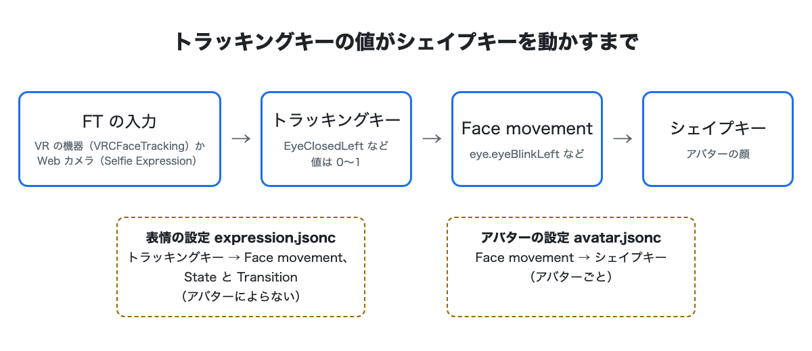
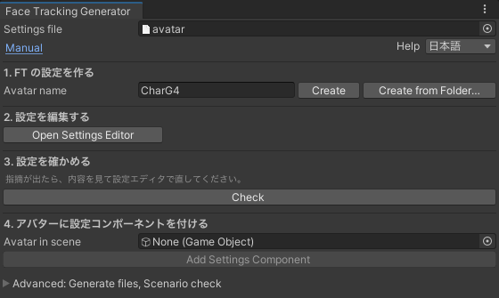
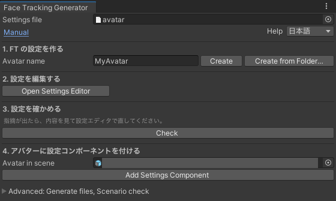
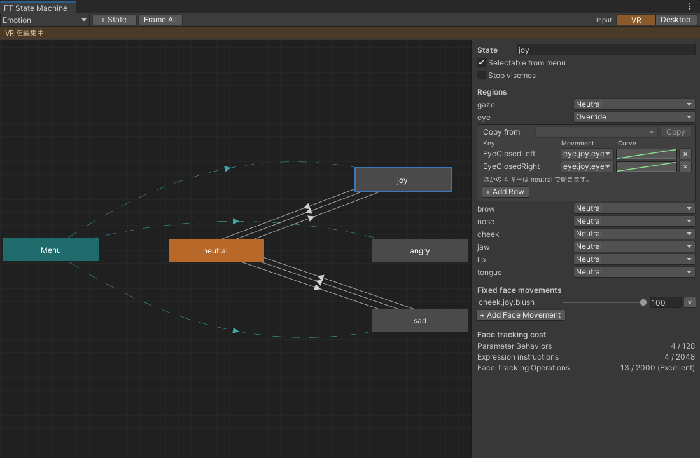
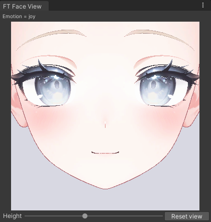
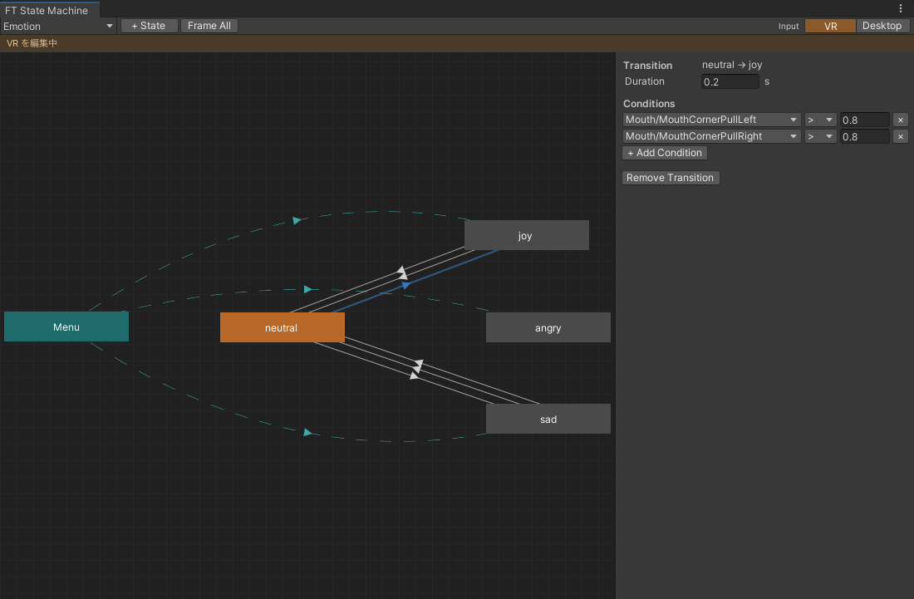
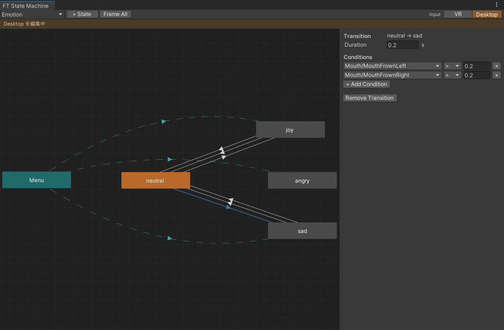
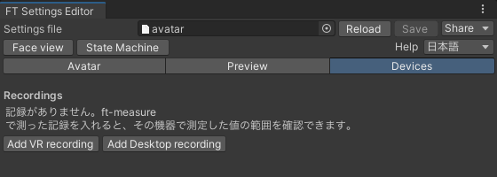
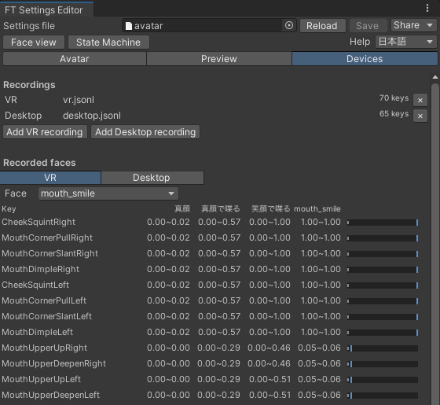
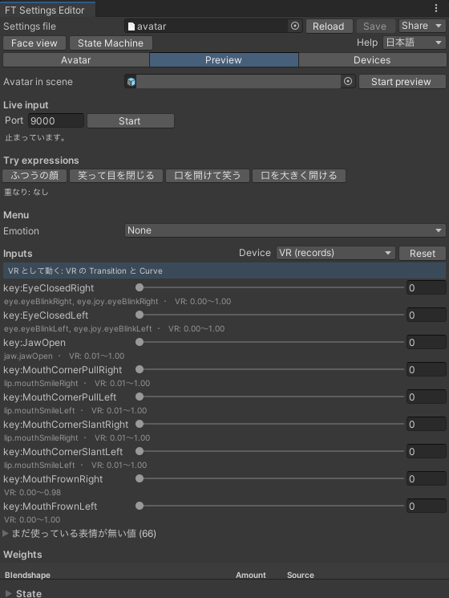

# Face Tracking Generator 説明書

Face Tracking Generator（FTG）は、VRChat のアバターのフェイストラッキング（FT）の設定を、Unity のエディタの中で作るツールです。この説明書は、FTG と一緒に配っている日本語の説明書です。設定ファイルの書き方や内部の振る舞いまで含めた英語の詳しいリファレンスは、リポジトリの README（https://github.com/kmnk/VRChat_FaceTrackingGenerator ）にあります。

FT の値を表情ごとに測るアプリ FT Measure（ft-measure）の使い方は、FT Measure の説明書（https://github.com/kmnk/ft-measure/blob/master/docs/manual-ja/README.md ）にあります。

## はじめに

### できること

- [Face movement](#用語集)（まばたき、口の開き、口角など）を、FT の値でアバターのシェイプキーに当てます
- `joy`・`angry`・`sad` のような [State](#用語集) を作り、State から State へ移る [Transition](#用語集) とその条件（FT の値）を、Unity の Animator に似たグラフで書けます
- State ごとに、目や口の動きを上書きできます。涙や頬の赤らみのようなシェイプキーを、その State の間ずっと一定の量で出しておくこともできます（**Fixed face movements** の欄で設定します）
- VRChat でアバターを着たときに開くメニュー（Expressions Menu）から、State を選べるようにできます
- VR の機器とデスクトップ（VRChat の Selfie Expression）で、Transition の条件や [Curve](#用語集) を分けて書けます
- FT の設定は、アップロードと Play Mode のタイミングで自動的に作成されます。元のアバターの各設定（コントローラー、Expressions Menu、Expression Parameters）は書き換えません

### 仕組み

VRChat は、VR の機器（VRCFaceTracking を通す）やデスクトップの Selfie Expression から、顔の値を受け取ります。値には `EyeClosedLeft`（左目の閉じ具合）や `JawOpen`（あごの開き）のような名前があり、この名前を[キー](#用語集)と呼びます。値は 0〜1 です。

FTG は、キーを Face movement（`eye.eyeBlinkLeft` など）に当て、Face movement をアバターのシェイプキーに当てます。この 2 段の対応を、2 つの設定ファイルに分けて持ちます。

- 表情の設定（`expression.jsonc`）: どのキーでどの Face movement を動かすか、どんな State があるか。アバターによらないので、別のアバターに持っていけます
- アバターの設定（`avatar.jsonc`）: Face movement ごとに、このアバターのどのシェイプキーを動かすか

Face movement とシェイプキーの対応は、VRChat のネイティブ FT（アバターの Avatar Descriptor の Face Tracking の区画）の [Blendshapes Set](#用語集) として書かれます。VRChat がシェイプキーを直接動かすので、FT の値をパラメータで同期しません。Transition の条件に使うキーだけは、VRChat の [Forward to Animator](#用語集) で Animator に渡します。

### neutral と State

どの State にも入っていないときの顔を [neutral](#用語集) と呼びます。neutral では、目・口などの [Region](#用語集) ごとに、キーが Face movement を動かします。

State（`joy` など）に入ると、その State が上書きする Region だけ、動き方が替わります。たとえば `joy` で目を上書きすると、`joy` の間は、まばたきのキーで動くシェイプキーを、ふだんのまばたきとは別のもの（たとえば目を弧の形にして閉じるシェイプキー）に替えられます。上書きしない Region は、neutral のまま動きます。

State は [State Machine](#用語集) の中にあり、Transition の条件（「左右の口角を上げる値がどちらも 0.8 を超えたら `joy` に入る」など）で切り替わります。State Machine は複数並べられます。

### VR とデスクトップ

VR の機器とデスクトップの Selfie Expression では、同じ顔をしても値の出方が違うことがあります。FTG は、Transition・Curve・Stop visemes を機器ごとに書けます。書かなければ両方で同じです。詳しくは「[VR とデスクトップで分ける](#vr-とデスクトップで分ける)」にあります。

## 動作環境

- Unity 2022.3（VRChat の推奨バージョン）
- VRChat SDK - Avatars 3.10.6 以上
- NDMF 1.14.7 以上 2.0.0 未満（FTG と一緒に入ります）
- PC 版の VRChat。Android（Quest）版の VRChat では確認していません
- VR の機器で使うときは、VRChat のネイティブ FT に値を送る VRCFaceTracking（Steam 版の 2026-11-02 の更新「Avalonia Update」以降。Steam 版は自動で更新されます）

## 入れ方

FTG は VPM のパッケージです。VCC か ALCOM で入れます。

1. NDMF のリポジトリを追加します: `https://vpm.nadena.dev/vpm.json`
   このリポジトリは Modular Avatar も配っていますが、FTG に要るのは NDMF だけです（Modular Avatar が入ったプロジェクトでも使えます）
2. FTG のリポジトリを追加します: `https://kmnk.github.io/vpm-repos/index.json`
3. Unity でプロジェクトを閉じてから、パッケージの一覧で **Face Tracking Generator** を追加します
4. Unity でプロジェクトを開き、メニューバーの `Tools/Kmnk/Face Tracking Generator` を開きます

リポジトリを追加できないときは、「[付録: zip から入れる](#付録-zip-から入れる)」を見てください。

## はじめての設定

この章では、アバターに FT を付けて、VRChat で顔が動くところまでを順に進めます。手順は、FTG のウィンドウに並んでいる 4 つ（「1. FT の設定を作る」「2. 設定を編集する」「3. 設定を確認する」「4. アバターに設定コンポーネントを付ける」）と、最後の Build & Test です。

アバターがパーフェクトシンク（ARKit の 52 種類のシェイプキー）に対応していれば、手順 2 でシェイプキーがほぼ自動で割り当てられます。対応していないアバターでは、手順 2 で Face movement ごとにシェイプキーを自分で選びます（「[パーフェクトシンクでないアバター](#パーフェクトシンクでないアバター)」）。

ウィンドウの上の **Help** で、説明と手順の見出しを日本語・英語・非表示に切り替えられます。この説明書の画像は日本語で撮っています。英語にすると、手順の見出しは Create the FT settings などになります。

### 1. FT の設定を作る

1. FTG のウィンドウの「1. FT の設定を作る」の **Avatar name** に、設定の名前（アバターの名前など）を入れます
2. **Create** を押します。設定が作成されると、ボタンの下に path が出て、**Settings file** に `avatar.jsonc` が入ります

設定は `Assets/Kmnk/FaceTrackingGenerator/Settings/<名前>/` に、次の 2 つのファイルとしてテンプレートから作成されます（2 つの役割は「[仕組み](#仕組み)」）。

- `avatar.jsonc`（アバターの設定）: Face movement ごとに、このアバターのどのシェイプキーを動かすか。手順 2 で選びます
- `expression.jsonc`（表情の設定）: パーフェクトシンクの 52 の名前を neutral で動かす設定と、中身が空の State `joy`・`angry`・`sad` を持つ State Machine `Emotion` が入っています

同じ名前の設定が既にあると、何も作成しません。そのときは **Settings file** で既にある設定を選んでください。

### 2. 設定を編集する

1. **Open Settings Editor** を押して設定エディタを開きます
2. **Avatar** タブで、アバターのプレハブを選び、**Fill from Prefab** を押します。顔のメッシュ、Expressions Menu、同じ名前のシェイプキーを持つ Face movement、空いている AFK のアニメーションの枠（アバター自身の AFK のレイヤーのクリップ）が埋まります（Undo で戻せます）。パーフェクトシンクのアバターなら、52 の Face movement のほとんどにシェイプキーが入ります
3. 一覧に *Not set* が残った Face movement は、アバターに合うシェイプキーがあれば選びます。全部を埋めなくてもかまいませんが、動くのはシェイプキーを選んだ Face movement だけです。パーフェクトシンクでないアバターでは Fill from Prefab で埋まるものが少ないので、少なくともまばたき（`eye.eyeBlinkLeft`・`eye.eyeBlinkRight`）と口の開き（`jaw.jawOpen`）を選んでください。1 つも選ばないと手順 5 で動くものが無く、手順 3 の Check が指摘します（選び方は「[パーフェクトシンクでないアバター](#パーフェクトシンクでないアバター)」）
4. **Menu** で、FT と AFK のトグルの名前と、それらを入れるサブメニューの名前（**Submenu name (optional)**、テンプレートの既定は `Face Tracking`）を確認します。サブメニューの名前を空にすると、トグルと State Machine のサブメニューがアバターの Expressions Menu の直下に並び、アバターの元の Expressions Menu と混ざるので、名前を入れておくのがおすすめです
5. **AFK animation (optional)** を開き、AFK の間に再生するクリップを見ます。Fill from Prefab は、空いている枠をアバター自身の AFK のレイヤーのクリップで埋めます。**Action Loop** と **FX Loop** の 2 つがあれば AFK が作成され、AFK のトグルも Expressions Menu に入ります（Intro と Outro は空なら飛ばします）。AFK が要らないときは、Loop の枠を空にします
6. **Save** を押します。保存できると、**State Machine** のボタンの右に出ていた **Unsaved changes** が消えます

画像は、パーフェクトシンクでないアバターで手順 6 まで進めた Avatar タブです。そのため *Not set* が多く残っています。シェイプキーとアセットの名前は隠しています。

### 3. 設定を確認する

FTG のウィンドウに戻り、**Check** を押します。指摘があれば、読んで設定エディタで直します。

設定に問題が無ければ、ボタンの下に「Check: 指摘はありません。」と出ます。

### 4. アバターに設定コンポーネントを付ける

1. シーンにアバターを置きます
2. FTG のウィンドウの **Avatar in scene** でアバターを選びます（Hierarchy で選んでも入ります）
3. **Add Settings Component** を押します。アバターに Settings Component（Face Tracking Generator Settings）が付き、ボタンの下に付けたことが出ます

画像のアバターの名前は隠しています。

Inspector でアバターを見ると、Settings Component に使う設定のファイルが出ています。FT の設定は、アップロードと Play Mode のタイミングで自動的に作成されます。

### 5. Build & Test で確認する

VRChat SDK の Build & Test でアバターをビルドし、VRChat で着替えます。

- VR の機器: VRCFaceTracking を動かしてから VRChat を起動します
- デスクトップ: VRChat の Selfie Expression を有効にします

FT が動いていると、シェイプキーを選んだ Face movement（まばたきや口の開きなど）が、自分の顔に合わせて動きます。Expressions Menu の **Face Tracking** のサブメニュー（手順 2 で決めた名前）に、FT のトグルと State Machine のサブメニューが出ます。FT の入力が無いと、アバターの元の表情に戻ります。顔が動かないときは「[困ったとき](#困ったとき)」を見てください。

## 表情を作る

「はじめての設定」で作成された設定の `joy` の State に、目と口の動きを追加します。

### State Machine のウィンドウを開く

設定エディタの **State Machine** のボタン（または `Tools/Kmnk/Face Tracking State Machine`）で、State Machine のウィンドウを開きます。オレンジの State が最初の State です。

### State の顔を作る

1. グラフで **joy** を選びます。右に State の設定が出ます
2. 目の Region（eye）を **Override** にし、**+ Add Row** で行を追加します。行は「キー → Face movement」です。たとえば `EyeClosedLeft` → `eye.joy.eyeBlinkLeft` にすると、`joy` の間は、左目のまばたきで `eye.joy.eyeBlinkLeft` に当てたシェイプキーが動きます（下の画像の行）
   - `joy` の間だけ使う Face movement は、先に設定エディタの Avatar タブの **+ Add Face Movement** で `eye.joy.eyeBlinkLeft` のように「Region.State.名前」で追加し、使いたいシェイプキー（目を弧の形にして閉じるシェイプキーなど）を当てておきます
3. 口の Region（lip）を **Off** にし、neutral の口の動きを止めます。口角を上げた口の形は、次の 4 で Fixed face movements として出します
4. **Fixed face movements** の **+ Add Face Movement** で、`joy` の間ずっと出す Face movement を 0〜100 で追加します。たとえば `lip.mouthSmileLeft` と `lip.mouthSmileRight` を 50 にすると口角が上がったまま、`cheek.joy.blush` のような頬の赤らみを追加すると頬が赤くなります
5. **Save** を押します

State を選ぶと、Face view にその State の顔が出ます。

Region の **Off** は、その Region の neutral の動きを止めます。**Don't move** の行は、そのキーで何も動かしません。**Copy from** で、別の State の行を写せます。

### Transition の条件を変える

テンプレートの Transition は、入り方の 3 つの見本になっています。

- joy: `MouthCornerPullLeft` と `MouthCornerPullRight` の両方が 0.8 を超えると入り、どちらかが 0.6 を下回ると出ます
- sad: `MouthFrownLeft` と `MouthFrownRight` で同じ形にし、値を機器ごとに分けています（VR は 0.6 で入り 0.4 で出る、デスクトップは 0.2 で入り 0.1 で出る）
- angry: Transition を持たず、Expressions Menu から選ぶだけです

値は目安です。FT Measure で利用者の顔を測り、Devices タブで値の幅を見て直してください（「[FT Measure で値の幅を見る](#ft-measure-で値の幅を見る)」）。

1. Transition（State の間の線）を選びます。右に **Conditions** と条件の値が出ます

2. 条件の値（[しきい値](#用語集)）を変えます。入りにくければ下げ、入りすぎるなら上げます。変えた値は Preview にもすぐ効きます
3. 1 本の Transition の条件は、すべて満たしたときに移ります（テンプレートの joy の入り方）。どれか 1 つで移る形は、同じ State の間に Transition を条件ごとに作ります（テンプレートの joy の出方）

### Preview で確認する

1. 設定エディタの **Preview** タブで、シーンのアバターを選び、**Start preview** を押します
2. スライダー（キー）を動かすと、顔と State が変わります
3. **Try expressions** は、崩れやすい表情にスライダーを合わせます。同じ所に重なる Face movement の数と、警告が出ます
4. **Stop preview** でアバターを元に戻します

Play Mode は要りません。アバターは書き換えません。

### Live input で自分の顔で確認する

VR の機器を持っているときは、Preview タブの **Live input** で、自分の顔でスライダーを動かせます。

1. VRChat を閉じ、VRCFaceTracking を機器と一緒に動かします
2. VRCFaceTracking の **Send Port** を、Live input の欄のポート（既定は 9000 で、VRCFaceTracking の既定と同じ）に合わせます
3. **Start** を押します

値が届き始めると、ボタンの下にそのことが出て、スライダーが顔に合わせて動きます。**Stop** で止めます。Send Port を変えたときは、VRChat を起動する前に戻してください。

### Build & Test で確認する

設定を変えたら、「[5. Build & Test で確認する](#5-build--test-で確認する)」と同じ手順でアバターをビルドし、VRChat で確認します。Transition の条件に合う顔をするとその State に入り、上書きした Region と Fixed face movements がその State の顔になることを見ます。Expressions Menu の State Machine のサブメニューでその State を選んだときにも、同じ顔になります。

## パーフェクトシンクでないアバター

アバターのシェイプキーの名前が ARKit の名前と違うときは、Avatar タブで Face movement ごとにシェイプキーを選びます。

- Face movement の行を押すと、検索できるシェイプキーの一覧が開きます。一覧を動かす間、Face view にそのシェイプキーを 100 にした顔が出ます
- 選ばなかった Face movement は *Not set* のままで、使われません。その数は一覧の見出し（**Face movements**）の右に出ます
- **[Scale](#用語集)**（0〜1、既定は 1）で、このアバターで強すぎるシェイプキーを弱められます。表情の設定は変わらないので、他のアバターに持っていっても影響しません
- **+ Add Face Movement** で Face movement を追加できます。Region の見出しの右の **+** でも同じです
- Face movement を右クリックして **Rename…** で、2 つの設定の両方で名前を変えられます。どの State も使わない Face movement は、ゴミ箱のボタン（画像を出せないときは **Del**）で消せます
- 一覧には、顔のメッシュのマテリアルの Float と Range のプロパティもあります。State の Fixed face movements にだけ使え、シェーダーで顔を描くアバターで、State に合わせて目や口を描き替えるのに使えます

### アバターの元のレイヤー

アバターの元の FX のレイヤーのうち、顔を動かすものを、FT の間どうするか決めます。

- **Stop while FT**: 手のジェスチャーで表情を変えるレイヤー
- **Mute while FT**: 何も入力が無くても顔を動かすレイヤー（ずっとまばたきさせるレイヤーなど）。これを止めないと、FT のまぶたの上にまばたきが重なります
- Expressions Menu からだけ動かすレイヤーは、そのままでかまいません

## VR とデスクトップで分ける

VR の機器とデスクトップの Selfie Expression では、同じ顔でも動くキーと値の幅が違うことがあります。FTG では、次を機器ごとに書けます。

- Transition（条件のキーと値）
- 行の [Curve](#用語集)
- State の Stop visemes

State の一覧、Expressions Menu、行のキーと Face movement、Fixed face movements は、両方の機器で共有します。

### 機器を切り替えて書く

1. State Machine のウィンドウの右上の **Input** で、書く機器（**VR** か **Desktop**）を選びます。ツールバーの下の帯に、どちらを書いているかが出ます

2. グラフには、その機器の Transition が出ます。Transition を追加したり条件を変えたりすると、その機器だけが変わります
3. 両方の機器で共通の Transition を変えると、その Transition は 2 つに分かれ、もう片方の機器は元のまま残ります

Preview タブの **Device** で VR かデスクトップを選ぶと、Preview はその機器の Transition と Curve で動きます。

### FT Measure で値の幅を見る

FT Measure は、利用者の顔で表情ごとに FT の値を測り、記録のファイル（`.jsonl`）に書くアプリです。記録を FTG に読ませると、どのキーがどのくらい動くかを見て、Transition のキーとしきい値を選べます。記録は参考に見るだけで、FTG の出力は変わりません。FT Measure を使わなくても、FTG は使えます。

測り方は FT Measure の説明書（https://github.com/kmnk/ft-measure/blob/master/docs/manual-ja/README.md ）にあります。測った後は次のとおり読ませます。

1. 設定エディタの **Devices** タブで、**Add VR recording** か **Add Desktop recording** を押し、記録のファイルを選びます。`avatar.jsonc` の隣の `Measurements/` に写されます

2. **Recorded faces** で、測った顔（**Face**）を選ぶと、キーごとに、**真顔**・**真顔で喋る**・**笑顔で喋る**・その顔（列の見出しは顔の id）での値の幅が出ます。真顔より大きく動くキーが上に並び、ほとんど動かないキーは薄く出ます

3. Preview タブの **Device** に **VR (records)** と **Desktop (records)** が出ます。選ぶと、スライダーの下にその機器の値の幅が出ます。幅の外では黄色、機器が送らないキーはオレンジです

画像の記録は作者が 2026-11-16 に VR の機器とデスクトップで測ったもので、アバターの名前は隠しています。

## State Machine の詳しい設定

### State と Transition を追加する

- State Machine のウィンドウのグラフの空いた所を右クリックして、State を追加します
- State を右クリックして **Make Transition** を選び、行き先の State を押すと、Transition ができます。**Set as Default** で最初の State にし、**Delete State** で消します
- State をドラッグして動かせます。マウスホイールで拡大・縮小、**F** か **Frame All** で全体を出します

### Expressions Menu から選べる State

State の **Selectable from menu** を入れると、Expressions Menu の State Machine のサブメニューに、その State のトグルが出ます。Expressions Menu で選んでいる間は Transition が動かず、トグルを切ると最初の State に戻ります。

### Stop visemes

State の **Stop visemes** を入れると、その State の間は、話しても声に合わせて口が動かなくなります（VRChat のリップシンクを止めます）。口の形を決めた State（舌を出すなど）で使います。

### Curve

行の **Curve** は、キーの値（横）に対して、Face movement をどのくらい動かすか（縦）を決める曲線です。押すと Unity の曲線のウィンドウで編集できます。曲線の一番高い所が、その行で動かす最大の量になります。

Curve の行は、VRChat の Parameter Behavior で動かします。数が多いと VRChat の上限を超えるので、State Machine のウィンドウの下の **Face tracking cost** を見てください。VRChat の上限を超えると赤、Excellent を超えると黄色で出ます。

### 別の State Machine を並べる

State Machine は複数並べられます。たとえば表情の `Emotion` とは別に、頬の State Machine `Cheek` を作り、Expressions Menu から選べる State `blush`（頬の赤らみ）と `pale`（青ざめた顔）を置くと、どの表情とも組み合わせられます。State Machine のウィンドウの左上の一覧で、**New State Machine…** を選んで作ります。2 つの State Machine が同じ Region を上書きしないようにしてください（**Check** が指摘します）。

## 画面ごとの説明

### FTG のウィンドウ

`Tools/Kmnk/Face Tracking Generator`。

| 名前 | 何をするか |
| --- | --- |
| Settings file | 使う設定（`avatar.jsonc`）。プロジェクトごとに最後に選んだものを覚えます |
| Avatar name | **Create** で作成される設定の名前。プロジェクトごとに覚えます |
| Manual | この説明書を開きます |
| Help | 説明を日本語・英語・非表示に切り替えます |
| Create | 入れた名前で、テンプレートから設定を作成します |
| Create from Folder… | **Share** で書き出したフォルダの表情の設定から、設定を作成します |
| Open Settings Editor | 設定エディタを開きます |
| Check | 保存した設定と、生成された FX のコントローラーを確認します |
| Avatar in scene | Settings Component を付けるアバター |
| Add Settings Component | アバターに Settings Component を付けます |
| Advanced: Generate files, Scenario check | 開くと、下の 2 つが出ます |
| Generate（Advanced） | アバターを書き換えずに、生成されたコントローラーと Prefab Variant を `Assets/FaceTrackingGeneratorOutput/<名前>/` に書きます |
| Scenario check (Play Mode)（Advanced） | FTG を確認するための機能です。**scenario .txt** にシナリオのファイルを選び、**Run scenario on the generated prefab** で顔を動かして記録します |

### 設定エディタ

`Tools/Kmnk/Face Tracking Settings Editor`（ウィンドウのタイトルは **FT Settings Editor**）。上の行に **Settings file**・**Reload**・**Save**・**Share**、その下に **Face view** と **State Machine** のボタンがあります。

| 名前 | 何をするか |
| --- | --- |
| Reload | 設定をファイルから読み直します |
| Discard | 保存していない変更があるときに別の設定を開くと出る確認のウィンドウのボタン。変更を捨てます |
| Save | 設定を保存します。保存すると、設定ファイルの `//` のコメントは消えます |
| Unsaved changes | 保存していない変更があるときに出ます（State Machine のウィンドウにも出ます） |
| Share | **Export expression…** で表情の設定をフォルダに書き出し、**Import expression…** でフォルダから読み込みます。アバターの設定は書き出しも上書きもしません |
| Resume | VRChat SDK のビルドが失敗して止まったままのときに、ウィンドウを再開します |

#### Avatar タブ

| 名前 | 何をするか |
| --- | --- |
| Prefab | FT のコントローラーを生成する対象の、アバターのプレハブ |
| Fill from Prefab | プレハブから、顔のメッシュ・Expressions Menu・同じ名前のシェイプキーを埋め、空いている AFK のアニメーションの枠をアバター自身の AFK のレイヤーのクリップで埋めます |
| Face mesh | 顔のメッシュ |
| Face movements | Face movement の一覧の見出し。右に、シェイプキーを選んだ数と Not set の数が出ます |
| Movement / Blendshape / Property / Scale | 一覧の列。Face movement、当てるシェイプキーかマテリアルのプロパティ（列の見出しは **Blendshape / Property**）、このアバターでの量の補正 |
| Menu | FT と AFK のトグルを入れる Expressions Menu |
| FT toggle name / AFK toggle name | Expressions Menu に入れる FT と AFK のトグルの名前 |
| Submenu name (optional) | トグルと State Machine のサブメニューを入れるサブメニューの名前。テンプレートの既定は `Face Tracking`。空なら Expressions Menu の直下 |
| AFK animation (optional) | AFK の間に再生するクリップ。**Action Intro**・**Action Loop**・**Action Outro**・**FX Intro**・**FX Loop**・**FX Outro** の 6 つで、Loop の 2 つだけが必須です |
| Not set | シェイプキーを選んでいない Face movement |
| unused | どの State も使わない Face movement に付く印 |
| Scale | このアバターで Face movement を動かす量の補正（0〜1） |
| + Add Face Movement | Face movement を追加します。開く小さなウィンドウ（見出しは **New face movement**）の **Name** に `Region.名前` を入れ、**Add** で追加し、**Cancel** でやめます |
| ゴミ箱 / Del | どの State も使わない Face movement を消します（ゴミ箱の絵を出せないときは Del と出ます） |
| Rename… | Face movement の名前を、2 つの設定の両方で変えます。開く小さなウィンドウは **Rename face movement** で、**Rename** で決めます |
| Layers | アバターの元のレイヤーの一覧。レイヤーを追加するときは、コントローラー（**FX**・**Gesture**・**Action**）を選びます。列は **Layer**（レイヤーの名前）と、Stop while FT・Mute while FT・**Remove**（一覧から外す） |
| Stop while FT / Mute while FT | FT の間、アバターの元のレイヤーを止めます（Stop while FT）・ミュートします（Mute while FT） |

#### Preview タブ

| 名前 | 何をするか |
| --- | --- |
| Start preview / Stop preview | シーンのアバターで顔を試します。止めると元に戻ります |
| Device | スライダーの下に値の幅を出す機器。選んだ機器で、Preview が VR とデスクトップのどちらの Transition と Curve で動くかも決まります。**None** は設定のまま |
| Menu | Expressions Menu で State を選んだときの顔を試します |
| Inputs | キーのスライダーの見出し |
| Reset | スライダーを 0 に戻します |
| Try expressions | 崩れやすい表情にスライダーを合わせます。ボタンは **ふつうの顔**・**笑って目を閉じる**・**口を開けて笑う**・**口を大きく開ける**・**目を見開く**・**横を見る**（Help が英語なら英語の名前） |
| Weights | 各シェイプキーを何が動かしているかを出します。**Amount** の列がその量、**Source** の列が動かしているもの（キーか State の Fixed face movements）です |
| Live input（Start / Stop） | VRCFaceTracking の値でスライダーを動かします。**Port** は受けるポート |

#### Devices タブ

| 名前 | 何をするか |
| --- | --- |
| Recordings | 記録の見出し。記録が無いときは、記録で何が分かるかが出ます |
| Add VR recording / Add Desktop recording | FT Measure の記録を `Measurements/` に写します |
| Recorded faces | 測った顔ごとの、キーの値の幅 |
| Face | 見る顔 |
| VR / Desktop | 見る記録の機器。State Machine のウィンドウの Input と一緒に切り替わります |

### State Machine のウィンドウ

`Tools/Kmnk/Face Tracking State Machine`（ウィンドウのタイトルは **FT State Machine**）。

| 名前 | 何をするか |
| --- | --- |
| 左上の一覧 | 表示する State Machine。**New State Machine…**・**Rename "<名前>"…**・**Delete "<名前>"…**。名前を入れる小さなウィンドウ（見出しは **New state machine** か **Rename state machine**）は **OK** で決めます |
| + State Machine | State Machine が 1 つも無いときに、State Machine を作成します |
| + State | State を追加します。グラフの空いた所の右クリックの **Create State** でも追加できます |
| Input | 書く機器（VR か Desktop） |
| Frame All | グラフ全体を表示します（**F** キーでも同じ） |
| State | 選んだ State の名前 |
| Selectable from menu | Expressions Menu から選べる State にします |
| Stop visemes | State の間、声に合わせて口を動かしません（リップシンクを止めます） |
| Regions | State の Region ごとの設定の見出し |
| Neutral / Override / Off | Region を neutral のまま・上書き・止める |
| + Add Row | 上書きする Region に行を追加します。追加できるキーが無いときは **(every key is written)** と出ます |
| Add Key/ / Remove Key/ | 最初の State で、Region の見出しの右クリックから、キーを追加・削除する |
| Don't move | その行のキーで何も動かしません |
| Copy from / Copy | 写す元の State を選び、**Copy** で行を写します |
| Key / Movement / Curve | 行の列。キー、動かす Face movement、Curve。Movement の選択肢の **New face movement…** と、Fixed face movements の **+ Add Face Movement** のメニューの **New face movement…** は、Face movement を追加する小さなウィンドウ（見出しは New face movement）を開きます |
| Curve | 行の Curve |
| Fixed face movements | State の間ずっと出す Face movement（0〜100） |
| Make Transition / Set as Default / Delete State | State の右クリックのメニュー。最初の State には **(default)** と出ます |
| Duration | 選んだ Transition の移り変わりの秒数 |
| Transition | 選んだ Transition（どこからどこへ） |
| Conditions | 選んだ Transition の条件。**+ Add Condition** で条件を追加します |
| Remove Transition | 選んだ Transition を消します |
| Face tracking cost | この設定から生成されるものの数と、パフォーマンスランク。**Parameter Behaviors**（VRChat の上限 128）、**Expression instructions**（上限 2048）、**Face Tracking Operations**（2000 を超えると Excellent でなくなる） |
| Open Settings Editor | 設定が開かれていないときに、設定エディタを開きます |

### Face view

`Tools/Kmnk/Face Tracking Face View`（ウィンドウのタイトルは **FT Face View**）。プレハブの顔を、シーンとは別に表示します。シェイプキーの一覧を動かす間は、そのシェイプキーを 100 にした顔、Preview の間は Preview の顔が出ます。ドラッグで顔を回せます。**Height** で見る高さを変え、**Reset view** で向きを戻します。

### Settings Component

アバターに付く **Face Tracking Generator Settings**。Inspector に使う設定のファイルが出て、設定エディタで開けます。右上の **?** は、この説明書の GitHub のページを開きます。

## 用語集

| 言葉 | 意味 |
| --- | --- |
| キー | VRChat が FT の入力から受け取る顔の値（Key）。`EyeClosedLeft`・`JawOpen` など。0〜1 |
| Face movement | 表情の設定の中の動きの名前。`eye.eyeBlinkLeft` のように「Region.名前」。アバターの設定で、シェイプキーに当てます |
| Region | 目（eye）・口（lip）など、State が上書きする単位 |
| neutral | どの State にも入っていないときの、Region ごとの動き |
| State | `joy` などの、顔の切り替え先。Region の上書きと、Fixed face movements を持ちます |
| State Machine | State と Transition のまとまり。複数並べられます |
| Transition | State から State への切り替え。キーの条件を持ちます |
| しきい値 | Transition の条件で、キーと比べる値 |
| Curve | キーの値に対する、Face movement を動かす量の曲線。一番高い所が最大の量（0〜1） |
| Scale | アバターごとの、Face movement を動かす量の補正 |
| Blendshapes Set | VRChat のネイティブ FT の、シェイプキーの組。FTG は Region と State ごとに生成します |
| Forward to Animator | キーの値を Animator のパラメータに渡す VRChat の機能。FTG は Transition の条件に使うキーだけを渡します |
| Forwarded Parameters | Forward to Animator で渡すパラメータの数。10 を超えると Excellent でなくなります |

## 更新と削除

### 更新のしかた

VCC か ALCOM のパッケージの一覧で、新しいバージョンを選びます。**Create** で作成された設定（`Assets/Kmnk/FaceTrackingGenerator/Settings/`）はパッケージの外にあるので残ります。`Packages/dev.kmnk.face-tracking-generator/` の中に自分のファイルを置かないでください。更新で消えます。

### 消し方

1. アバターから Settings Component（Face Tracking Generator Settings）を外します
2. パッケージの一覧から Face Tracking Generator を外します
3. 要らなければ、`Assets/FaceTrackingGeneratorOutput/` と `Assets/Kmnk/FaceTrackingGenerator/Settings/` を消します

## 困ったとき

### 顔が動かない

- VRChat に FT の入力が無いと、アバターの元の表情に戻ります。VR の機器では VRCFaceTracking が動いているか、デスクトップでは Selfie Expression が有効かを見てください
- VRCFaceTracking が古い（Steam 版の 2026-11-02 の更新「Avalonia Update」より前）と、値をアバターのパラメータとして送るので、FTG は読めません。VRCFaceTracking を更新してください
- アバターの Face Tracking の区画に既に値があると、FTG はその値を残し、FTG の値を書きません。FTG の値で上書きするには、`avatar.jsonc` に `"overwriteFaceTracking": true` を書きます

### まばたきが重なる

- neutral がまぶたを動かす（`EyeClosedLeft` か `EyeClosedRight` を使う）と、生成したアバターの Eye Look の Eyelids Type は自動で Face Tracking になり、Eye Look のまぶたは FT のまぶたに重なりません
- アバターの元のレイヤーに、ずっとまばたきさせるレイヤーがあると、FT のまぶたの上に重なります。Avatar タブでそのレイヤーを **Mute while FT** にしてください

### Excellent でなくなる

- Transition の条件に使うキーが 10 を超えると、[Forwarded Parameters](#用語集) で Excellent でなくなります
- VR とデスクトップで Curve を分けると、Blendshapes Set の数が約 2 倍になります。**Face tracking cost** を見てください

### ウィンドウが止まったまま

- VRChat SDK がビルドしている間、設定エディタ・Face view・State Machine のウィンドウは止まります。ビルドが失敗して止まったままのときは **Resume** を押してください

### NDMF の Manual Bake で FT が無い

- NDMF の Manual Bake では、FTG はエラーで止まり、FT の設定が作成されません。Play Mode かアップロードで確認してください

### Live input の後に VRChat で顔が動かない

- Live input のために VRCFaceTracking の Send Port を変えたときは、VRChat を起動する前に戻してください

## 問い合わせとライセンス

### 問い合わせ

不具合の報告と問い合わせは、BOOTH のメッセージか、GitHub の Issues（https://github.com/kmnk/VRChat_FaceTrackingGenerator/issues ）で受けます。返事ができないこともあります。

次のことには対応しません。

- アバターごとの設定を作ること、シェイプキーの割り当ての代行
- 他の表情の改変のツールと組み合わせたときの振る舞い
- VRCFaceTracking と FT の機器の設定
- 2026-11-02 の「Avalonia Update」より前の VRCFaceTracking、Unity 2022.3 以外、Android 版の VRChat

### ライセンスと無保証

FTG は MIT ライセンスです（パッケージの `LICENSE.txt`）。無保証で、作者は使ったことで生じた損害の責任を負いません。使うかどうかは、ご自身の判断と責任でお願いします。

## 付録: zip から入れる

VCC か ALCOM にリポジトリを追加できないときは、zip から入れられます。

1. `dev.kmnk.face-tracking-generator-<バージョン>.zip` を、消さずに置いておけるフォルダに展開します（`package.json` がフォルダの直下に来ます）
2. VCC の **Settings** の **Packages** にある **User Packages** の **Add** で、展開したフォルダを選びます
3. アバターのプロジェクトの **Manage Project** で **Face Tracking Generator** を追加します。NDMF も要るので、NDMF のリポジトリ（`https://vpm.nadena.dev/vpm.json`）を追加しておきます

この入れ方では、新しいバージョンが出ても一覧から更新できません。新しいバージョンの zip を展開し、User Packages を新しいフォルダに替えてください。消し方は VCC で入れたときと同じです。
